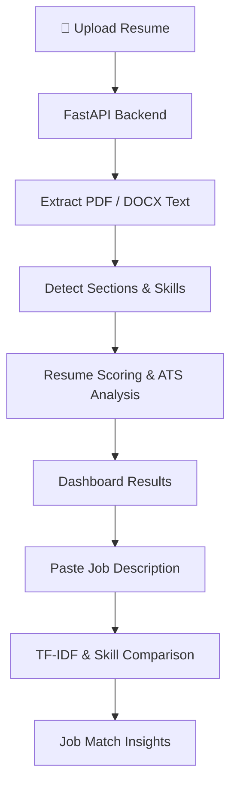

# ✦ Resume Scanner

### Turn your resume into a career-ready profile.

**Understand your resume. Measure its strengths. Discover how well it matches your next opportunity.**

Resume Scanner is a full-stack resume analysis and job-matching platform that transforms PDF and DOCX resumes into structured, actionable insights. It evaluates resume quality, detects ATS-related issues, identifies professional skills, and compares your profile against a target job description.

\<p align="center">   \   \   \   \ \</p>

\<p align="center">   \<b>Resume Intelligence · ATS Analysis · Job Compatibility\</b> \</p>

---

## ◈ Project Preview

\<!-- Replace these paths with your actual screenshots -->

\<p align="center">   \ \</p>

\<p align="center">   \<i>A unified workspace for resume insights and job compatibility analysis.\</i> \</p>

---

## ✨ What makes it useful?

| Capability               | What it delivers                                                 |
| ------------------------ | ---------------------------------------------------------------- |
| 📄 Resume Parsing        | Extracts content from PDF and DOCX documents                     |
| 🧩 Section Detection     | Identifies education, experience, skills, projects and more      |
| 🛠️ Skill Intelligence   | Detects and categorizes skills using a built-in taxonomy         |
| 📊 Resume Scoring        | Evaluates completeness, action verbs and measurable achievements |
| 🎯 ATS Analysis          | Highlights keywords, formatting concerns and contact issues      |
| 🔍 Job Matching          | Compares your resume against a target job description            |
| 📈 Match Insights        | Shows matched skills, missing skills and text similarity         |
| 📱 Interactive Dashboard | Presents analysis results in a structured interface              |

## 🧠 How the analysis works

Resume Scanner combines document processing, rule-based evaluation and traditional machine learning techniques.

**1. Document extraction**

- Reads text from PDF and DOCX files.
- Uses `pdfplumber` and `python-docx`.

**2. Resume understanding**

- Detects common resume sections.
- Extracts skills from a predefined taxonomy.
- Estimates experience using detected date ranges.

**3. Resume evaluation**

- Checks section completeness.
- Evaluates action verbs and quantified achievements.
- Reviews resume length and ATS-related indicators.

**4. Job compatibility**

- Applies TF-IDF text vectorization.
- Calculates cosine similarity.
- Compares detected resume skills with job requirements.
- Identifies matching and missing skills.

> **Important:** This application does not use an external generative AI service. Its results are generated using rule-based heuristics and TF-IDF.

---

## 🏗️ Technology Stack

| Layer             | Technologies         |
| ----------------- | -------------------- |
| Frontend          | React 19, JavaScript |
| Build Tool        | Vite 8               |
| Backend           | Python, FastAPI      |
| Machine Learning  | scikit-learn         |
| PDF Processing    | pdfplumber           |
| DOCX Processing   | python-docx          |
| API Communication | REST API             |

## 🔄 Application Workflow



## 🚀 Getting Started

### Prerequisites

- Python 3.12 or later
- Node.js 20.19+ or 22.12+
- npm

### 1. Clone the repository

```bash
git clone <YOUR_GITHUB_REPOSITORY_URL>
cd resume-analyzer
```

### 2. Configure the backend

Open a terminal from the repository root.

**Windows PowerShell**

```powershell
cd backend

python -m venv .venv
.venv\Scripts\Activate.ps1

pip install -r requirements.txt

uvicorn main:app --reload --port 8000
```

**macOS / Linux**

```bash
cd backend

python3 -m venv .venv
source .venv/bin/activate

pip install -r requirements.txt

uvicorn main:app --reload --port 8000
```

Backend:

- API: [http://localhost:8000](http://localhost:8000)
- Interactive documentation: [http://localhost:8000/docs](http://localhost:8000/docs)

### 3. Configure the frontend

Open a second terminal.

```bash
cd frontend

npm ci
npm run dev
```

Open the local URL displayed by Vite:

[http://localhost:5173](http://localhost:5173)

**Optional API configuration**

The frontend defaults to `http://localhost:8000`.

To configure a different backend, create `frontend/.env` using `frontend/.env.example`:

```env
VITE_API_BASE=http://localhost:8000
```

---

## 🔌 API Reference

| Method | Endpoint                   | Purpose                               |
| ------ | -------------------------- | ------------------------------------- |
| GET    | `/api/health`              | Check backend health                  |
| POST   | `/api/upload`              | Upload and process a resume           |
| POST   | `/api/analyze/{resume_id}` | Generate resume and ATS analysis      |
| POST   | `/api/match`               | Compare resume with a job description |
| DELETE | `/api/resume/{resume_id}`  | Delete uploaded resume data           |

### Job Matching Request

`POST /api/match`

```json
{
  "resume_id": "id-returned-by-upload",
  "job_description": "Paste the target job description here."
}
```

---

## 📂 Project Structure

```text
resume-analyzer/
│
├── backend/
│   ├── app/
│   │   ├── matcher.py       # TF-IDF job matching
│   │   ├── models.py        # API request/data models
│   │   ├── parser.py        # Resume text extraction
│   │   ├── scorer.py        # Resume scoring and ATS checks
│   │   ├── skills.py        # Skill extraction
│   │   └── skills_db.py     # Skill taxonomy and headers
│   │
│   ├── main.py              # FastAPI application
│   └── requirements.txt
│
└── frontend/
    ├── src/
    │   ├── components/      # Dashboard components
    │   ├── App.jsx
    │   └── api.js           # API communication
    │
    ├── .env.example
    └── package.json
```

## 🖼️ Screenshots

Add screenshots of your actual running application to showcase its interface.

| Dashboard                   | Resume Analysis            |
| --------------------------- | -------------------------- |
| `screenshots/dashboard.png` | `screenshots/analysis.png` |

| Skill Detection          | Job Matching                |
| ------------------------ | --------------------------- |
| `screenshots/skills.png` | `screenshots/job-match.png` |

\<!-- Uncomment after adding actual screenshots:  \<p align="center">   \   \ \</p>  -->

## 🔐 Privacy & Technical Limitations

- No external AI provider is used.
- Uploaded resume content is processed by the configured backend.
- Resume text is stored in memory, not permanent database storage.
- Restarting the backend clears the in-memory resume data.
- The delete API endpoint can remove stored resume data.
- Only text-based PDF and DOCX files are supported.
- Scanned or image-only PDFs may fail without OCR.
- Resume scoring and experience estimation are heuristic-based.
- TF-IDF similarity is not a guaranteed measure of candidate suitability.
- The current implementation is designed for local development and does not include production-grade authentication or persistent storage.

**Production considerations:** Add authentication, secure file handling, input validation, rate limiting, persistent storage, data retention controls and appropriate privacy safeguards before allowing public users to upload resumes.

## 🧪 Development & Quality Checks

Run these commands from the `frontend/` directory:

```bash
npm run build
npm run lint
```

## 🗺️ Future Improvements

- [ ] OCR support for scanned resumes.
- [ ] Downloadable resume analysis reports.
- [ ] More advanced ATS keyword recommendations.
- [ ] Resume improvement suggestions.
- [ ] Persistent and secure resume storage.
- [ ] User authentication and personal dashboards.
- [ ] Enhanced job-description comparison.
- [ ] Automated testing and deployment.

## 📜 License

No license has been specified yet.

---

\<p align="center">   \<b>Built to make resume analysis more transparent and actionable.\</b>   \<br />   \<sub>Resume Scanner · Full-Stack Development Project\</sub> \</p>
